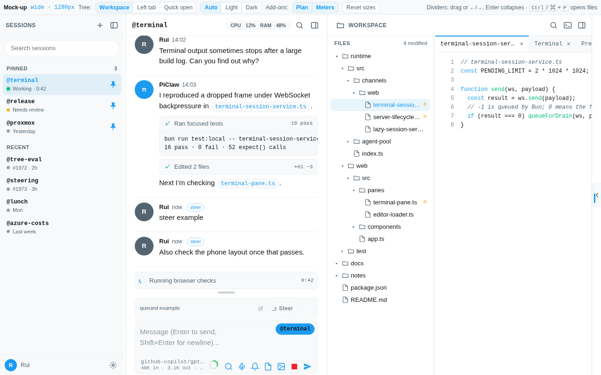
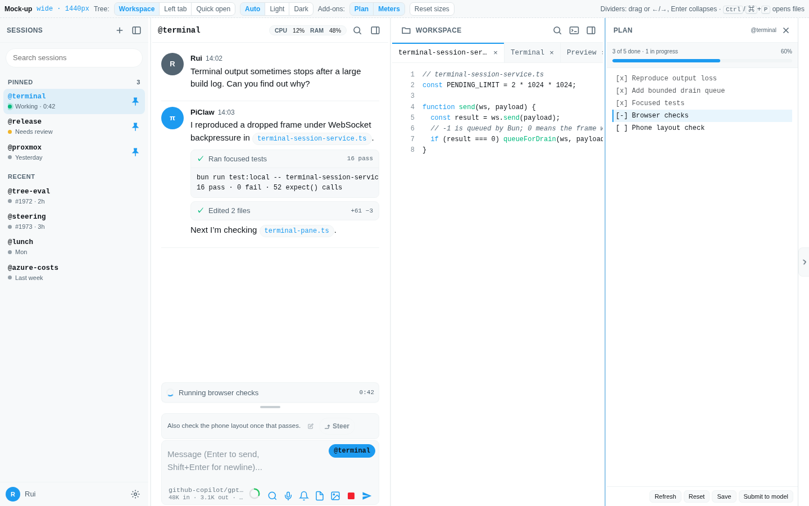
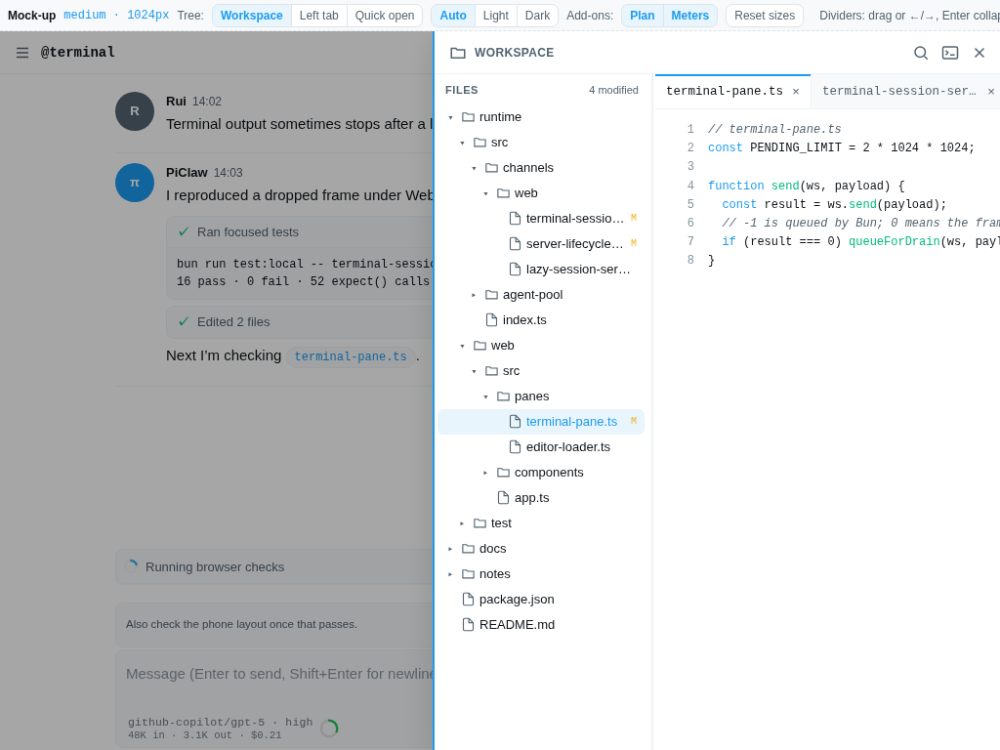
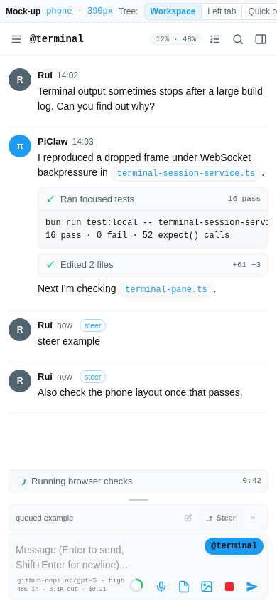
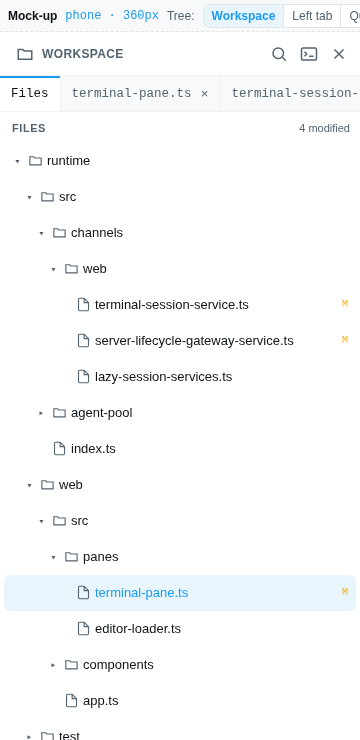

# Classic three-pane layout mock-up

Interactive mock-up for [#1987](https://github.com/rcarmo/piclaw/issues/1987): pinned and recent sessions on the left, chat in the middle, and a workspace pane for files, editors, the terminal and previews on the right. It applies to the Classic skin only.

Open [`mockup.html`](mockup.html) in a browser. It is a self-contained static file with no external requests, and its sample data is fake. It shows the intended structure and behaviour; it is not production code.

## What the mock-up shows

- Three panes that can be resized by dragging or from the keyboard, collapsed and restored. The chat never becomes narrower than 420 px.
- A file tree inside the workspace pane that can be resized, collapsed by dragging, or toggled from the workspace header or with Ctrl/⌘+Shift+E. It hides automatically when the workspace is too narrow for both the tree and an editor. The mock-up bar also compares two alternatives: a Files tab in the left pane, and quick open only.
- The current Classic compose box: the queue stack, input resize handle, `@session` trigger, model and usage line, context pie, action icons, and send and stop. The agent status sits between the timeline and the compose box. Enter queues while the agent is busy; Ctrl/⌘+Enter steers.
- A layout slot for the plan sidebar add-on. It is a resizable column on the far right with its existing edge tab in a reserved gutter, so it does not overlay the workspace.
- The system meters docked in the chat header. They no longer float over the conversation and workspace.
- Add-on toggles in the mock-up bar, which show the layout with and without the plan add-on and the meters.

## Responsive behaviour

| Width | Sessions | Chat | Workspace | Plan add-on | Meters |
|---|---|---|---|---|---|
| ≥ 1100 px | Inline pane | Inline, ≥ 420 px | Inline pane with tree column | Inline column | Chat header, sparklines when room allows |
| 640–1099 px | Overlay drawer | Full width | Overlay drawer with tree column | Overlay drawer | Chat header |
| < 640 px | Full-screen sheet | Full width, Classic mobile tokens | Full-screen sheet; tree is a Files tab | Full-screen sheet from a header button | Compact summary in the header |

## Screenshots

| | |
|---|---|
| Desktop, 1280 px |  |
| Desktop with plan open, 1440 px |  |
| Tablet workspace drawer, 1024 px |  |
| Phone chat, 390 px |  |
| Phone Files tab, 360 px |  |

## Validation

A throwaway Playwright script exercised the mock-up in Chromium and WebKit at 1440, 1280, 1024, 768, 390 and 360 px. It checked the following:

- No horizontal overflow.
- Divider and drawer resizing, collapse, restore and persistence.
- The chat minimum width.
- File tree toggle, shortcut, drag-collapse and auto-hide, and the phone Files tab.
- Opening files from chat links, the tree and quick open.
- Compose queueing and steering, and the session-pill spacing.
- Plan add-on placement with the add-on present and absent.
- The meters docked in the header.

The script is not part of the repository test suite.

## Implementation notes

The Classic implementation keeps the existing shell markup and class names, and reorders the existing panes inside `.app-shell`. It differs from the mock-up in these places:

- The system meters stay in the chat's top-right corner instead of a new chat header.
- Narrow layouts keep the compose `@session` picker for sessions instead of adding a sessions drawer.
- The plan sidebar docks by setting `--piclaw-shell-inset-right`. The add-on change is separate.
- Session rows include the session-dashboard add-on's summaries: activity state, live draft, thinking or tool previews, the latest reply and its age, and context use. `/agent/active-chats` now returns `last_activity_at` and a 400-character `last_reply` excerpt for each session.
